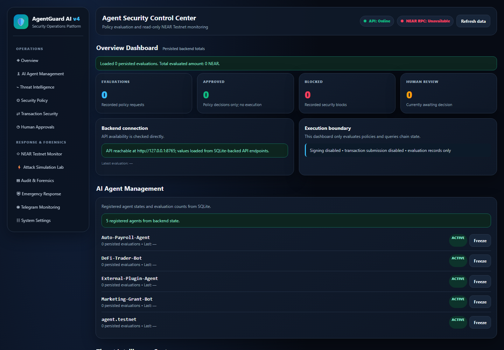

# AgentGuard AI v4

**A NEAR Testnet read-only security prototype for evaluating agent payment requests.**

AgentGuard AI demonstrates policy controls around payment requests from
software agents. The backend evaluates each request, records its decision in
SQLite, and routes higher-risk requests to authenticated human review. The v4
foundation app does not hold wallet keys or execute transactions.

## Problem and approach

Autonomous agents can generate payment requests faster than a human can review
them. This prototype places explicit server-side controls between a request
and any hypothetical payment executor: recipient allowlists, spending limits,
duplicate and velocity checks, prompt-pattern checks, a kill switch, and human
review. There is no payment executor in this project.

The word “AI” in the project name does not mean a model decides whether a
request passes. Security decisions use deterministic backend rules; model
inference is not a policy input in this implementation.

AgentGuard AI records explainable `APPROVE`, `REVIEW`, and `BLOCK` decisions using deterministic server-side rules. It does not sign, authorize, or submit blockchain transactions. It does not use an AI model to make security decisions.

The v4 dashboard is served by `app.main_v3:app` at `/dashboard-v4` on port 8000. Its foundation API is mounted at `/v4/api/v1`; existing v3 API routes remain available at their original paths. Earlier dashboard files remain in the repository.

> **Hackathon prototype:** The policy engine, local audit store, and tests demonstrate a security workflow. They are not a production financial authorization service and do not provide tamper-proof audit guarantees.

## Project status

| Status | Features |
| --- | --- |
| **Implemented** | FastAPI foundation; deterministic server policy; validation, SQLite persistence, evaluation idempotency, agent freeze, global kill switch, policy revisions, protected human approvals, correlated request IDs, persisted simulations, sanitized public activity, linked SHA-256 audit events with verification/export, optional server-side Telegram alerts, and read-only NEAR client. |
| **Tested** | The complete suite passed **70 tests with 1 existing warning** on 2026-11-13; browser and API evidence is recorded below and in `docs/TESTING.md`. |
| **Mocked** | Automated NEAR RPC tests use mocked provider replies. Simulations use generated requests but execute the real local policy engine. Telegram delivery tests must mock the provider; no real delivery is implied. |
| **Unverified** | Continued NEAR RPC availability beyond the point-in-time checks below, actual Telegram delivery, cross-browser/mobile/accessibility review, deployment security, and multi-process consistency. |
| **Planned / limited** | A SHA-256 chain detects edits but SQLite remains operator-editable; no external immutable anchor/signature exists. Authentication is one shared bearer token, migrations are additive rather than managed by Alembic, and public threat intelligence is not connected. |

See [Architecture](docs/ARCHITECTURE.md), [Threat Model](docs/THREAT_MODEL.md), [Security Policy](docs/SECURITY_POLICY.md), [API Reference](docs/API.md), [Demo Walkthrough](docs/DEMO.md), [Known Limitations](docs/LIMITATIONS.md), and the [Submission Checklist](docs/SUBMISSION_CHECKLIST.md).

## Key features

- Deterministic recipient, spending, duplicate, velocity, prompt-pattern,
  tool, contract, and agent-state checks.
- Authenticated human approval and rejection with expiry and policy
  re-evaluation.
- SQLite persistence for policy, evaluations, simulations, and audit events;
  SHA-256 links detect sequence edits but are not tamper-proof.
- Emergency kill switch, policy history, request correlation, and sanitized
  public activity views.
- Read-only NEAR Testnet status and account monitoring. RPC availability can
  change independently of the application.

## Installation and configuration

Requirements: Python 3.12 or newer and PowerShell on Windows. From the repository root:

```powershell
python -m venv backend\.venv
backend\.venv\Scripts\Activate.ps1
python -m pip install -r backend\requirements-foundation.txt
$env:AGENTGUARD_ADMIN_TOKEN = 'replace-with-a-long-random-local-demo-token'
$port = if ($env:AGENTGUARD_PORT) { [int]$env:AGENTGUARD_PORT } else { 8000 }
if ($port -lt 1 -or $port -gt 65535) { throw 'AGENTGUARD_PORT must be between 1 and 65535' }
python -m uvicorn app.main_v3:app --app-dir backend --host 127.0.0.1 --port $port
```

`app.main_v3:app` is the primary combined entry point for the v4 dashboard and
the existing API routes. The standalone `app.foundation.main:app` app is for
isolated foundation use and is not the dashboard server documented here.

If Uvicorn reports that port 8000 is already in use, inspect the listener
before starting another copy:

```powershell
Get-NetTCPConnection -LocalPort 8000 -State Listen | Select-Object LocalAddress, LocalPort, OwningProcess
Get-Process -Id <PID>
```

Only stop a process after confirming it is the AgentGuard instance you intend
to replace. If another process must keep that port, set `$env:AGENTGUARD_PORT`
to a free port (for example, `8002`) and rerun the startup block. The URLs then
use that port. The normal startup command omits Uvicorn reload mode to keep one
server process; add `--reload` only during active development.

Open these local URLs:

- Dashboard: `http://127.0.0.1:8000/dashboard-v4`
- v3 interactive API docs: `http://127.0.0.1:8000/docs`
- v4 interactive API docs: `http://127.0.0.1:8000/v4/docs`
- v4 OpenAPI schema: `http://127.0.0.1:8000/v4/openapi.json`
- v4 database health: `http://127.0.0.1:8000/v4/api/v1/health`
- v4 NEAR RPC health: `http://127.0.0.1:8000/v4/api/v1/near/health`

The database defaults to `backend/agentguard_foundation.db`, independent of the process working directory. Set `AGENTGUARD_DATABASE_URL` to select another SQLite file; missing parent directories are created during engine setup. The supported configuration variables are:

| Variable | Default | Purpose |
| --- | --- | --- |
| `AGENTGUARD_PORT` | `8000` | Loopback Uvicorn port used by the documented PowerShell startup command. |
| `AGENTGUARD_ADMIN_TOKEN` | `agentguard-local-demo-token` | Bearer token for admin-only policy changes, reviews, audit listing and simulation operations. Override for shared deployments. |
| `AGENTGUARD_DATABASE_URL` | `backend/agentguard_foundation.db` | SQLite storage location; relative override paths resolve from the process working directory. |
| `AGENTGUARD_NEAR_TESTNET_RPC_URL` | `https://rpc.testnet.near.org` | HTTPS NEAR RPC endpoint; client rejects non-Testnet chain IDs. |
| `AGENTGUARD_NEAR_RPC_TIMEOUT_SECONDS` | `5` | RPC request timeout, from 0.1 to 60 seconds. |
| `AGENTGUARD_ENVIRONMENT` | `development` | Runtime environment label. |
| `AGENTGUARD_LOG_LEVEL` | `INFO` | Structured log level. |

The local token is intended for loopback demos only. Keep Uvicorn bound to `127.0.0.1` for local use, and use a unique token outside the local demo. Optional Telegram settings are `AGENTGUARD_TELEGRAM_BOT_TOKEN` and `AGENTGUARD_TELEGRAM_CHAT_ID`; secrets are never returned to the browser. Full steps are in [Installation](docs/INSTALLATION.md).

## Payment security workflow

```text
Payment Request → Policy Evaluation → APPROVE / BLOCK / REVIEW → Human Approval (for REVIEW) → Audit Record
```

1. **Payment request:** `POST /v4/api/v1/evaluations` validates the request and requires an `Idempotency-Key`. It accepts no private key, seed phrase, or signing material.
2. **Policy evaluation:** the backend checks agent state, prompt patterns, recipient allow/block lists, spending thresholds, duplicate history, velocity, and optional tool/contract policy.
3. **Decision:** a passing request below the review threshold is `APPROVE`; a failed check is `BLOCK`; a request above the review threshold is `REVIEW`. `APPROVE` is only a policy result and never submits a transaction.
4. **Human approval:** a `REVIEW` request is persisted as pending. Admin-only approve/reject calls require the bearer token. Approval rechecks current policy; expired requests are blocked.
5. **Audit record:** the initial policy result and its audit event are committed together. Human decisions, expirations, policy changes and other covered events add further audit rows. Audit listing is admin-only. The SQLite log is not tamper-proof against direct database edits.

The request and review API details are in [API Reference](docs/API.md). No NEAR account is needed for policy evaluation; the separate Testnet monitor performs public read-only queries.

## System architecture

```text
Browser dashboard
  └─ FastAPI app: app.main_v3:app
       ├─ existing v3 routes
       └─ /v4 mount: foundation API
            ├─ deterministic policy + human review
            ├─ SQLite persistence + linked audit events
            └─ read-only NEAR Testnet RPC client
```

The combined app serves `/dashboard-v4` and mounts the v4 API at
`/v4/api/v1/`. The foundation app owns its configuration, database lifecycle,
routes, and NEAR client. See [Architecture](docs/ARCHITECTURE.md) for details.

The main API surfaces are health (`GET /v4/api/v1/health`), policy evaluation
(`POST /v4/api/v1/evaluations`), admin-only review decisions and audit
operations, and read-only NEAR monitoring under `/v4/api/v1/near/`. Full paths,
request examples, and authentication requirements are in the [API Reference](docs/API.md).

## Testing

From the repository root, install the project requirements and run all backend tests:

```powershell
python -m pip install -r backend\requirements.txt
backend\.venv\Scripts\python.exe -m pytest -p no:cacheprovider -p no:tmpdir -q
```

The browser smoke test requires Playwright and Microsoft Edge; install `backend/requirements-browser.txt` to include it. Tests use disposable SQLite data and mocked NEAR RPC responses; they do not broadcast transactions. The latest complete run on this revision was **70 passed, 1 warning** (`20.76s`, exit 0). The warning is Starlette's `TestClient`/`httpx` deprecation. See [Test Instructions](docs/TESTING.md) for commands and coverage limits.

## Local demo

1. Start Uvicorn using the installation command and open `http://127.0.0.1:8000/dashboard-v4`.
2. Enter the configured admin token under **System Settings** to load protected approvals, audit, and simulation views.
3. Submit a small request to `treasury.testnet` and observe the server decision and updated counts.
4. Submit a request above the review threshold, then approve or reject it in Human Approval Center. The approval is revalidated and does not execute a payment.
5. Submit a request to `attacker.testnet` to demonstrate the blocklist, or use Simulation Lab to run all 12 backend scenarios.
6. Review the persisted Recent Activity. Enter the admin token to access full audit data, verify the audit hash chain, or export JSON/CSV.
7. Optionally enable the global kill switch; it blocks all new v4 evaluations until an authenticated operator disables it.
8. Check the NEAR monitor separately. It reports current RPC results when available; mocked tests are not live-chain evidence. Telegram stays disabled unless both server environment settings are configured.

See [Demo Walkthrough](docs/DEMO.md) for a fuller presentation sequence.

## Demo video

The demo recording is not linked in this repository yet. The accessible local
Desktop, Videos, and Downloads recordings were checked; the inspected files do
not demonstrate AgentGuard AI. No public demo URL was present in the project,
so none is fabricated. Before external submission, add the verified recording
at `docs/demo/agentguard-ai-v4-demo.mp4` or add its verified public host URL
here and in [Demo Walkthrough](docs/DEMO.md), then confirm playback and that it
contains no credentials.

## NEAR integration boundary

The NEAR client permits only read-only `status`, `query`, and `tx` status methods. It checks the RPC `chain_id` before account and transaction lookups. Account lookup uses finalized `view_account`; transaction lookup uses status at `FINAL`. The explorer URL is returned only after the RPC result’s hash and signer match the request. See the [NEAR RPC account documentation](https://docs.near.org/api/rpc/contracts) and [transaction status documentation](https://docs.near.org/api/rpc/transactions).

Point-in-time read-only evidence from 2026-11-13: `/v4/api/v1/near/health` returned HTTP 200 with `network=testnet` and 3813 ms latency; `/v4/api/v1/near/accounts/wrap.testnet` returned HTTP 200 with Testnet account metadata. These checks queried RPC status/account data only. No transaction was looked up, signed, or submitted, and RPC availability can change.

There is no transaction signing, broadcasting, wallet connection, private-key handling, or automatic execution code in the v4 foundation app. An `APPROVE` is a policy decision only. The older v2/v3 demos also label approval as policy-only and no longer manufacture chain balances or explorer receipts. Read the [limitations](docs/LIMITATIONS.md) before presenting the prototype as a guarantee or production control.

## Screenshots

See [verified local screenshots](docs/screenshots/README.md). They were captured from the locally running app and document the actual empty-database and RPC-unavailable state at capture time; no seeded metrics or successful RPC state is implied.



## Exact next steps for submission

1. On the final checkout, follow [Installation](docs/INSTALLATION.md) from a clean virtual environment and run the full suite using [Test Instructions](docs/TESTING.md).
2. Start the app on loopback, check API health and OpenAPI docs, and run the 12-scenario suite through the authenticated Simulation Lab. Save the resulting actual scorecard and audit output for the demo.
3. Recheck the Testnet RPC immediately before the presentation. If it remains unavailable, show the documented error state and identify the automated RPC checks as mocked.
4. Fill in the team, repository, project category, demo link and event-specific form fields after confirming the current hackathon rules, deadline, and whether a demo video is required (including duration, format, and hosting requirements).
5. Review the final Git diff, license and assets, README claims, screenshots, and [submission checklist](docs/SUBMISSION_CHECKLIST.md); submit only the revision that was reviewed.

## License

MIT; see [LICENSE](LICENSE).

## Technology and contributions

The project uses Python, FastAPI, Pydantic, SQLAlchemy, SQLite, HTML/CSS, and
browser-side JavaScript. NEAR access uses public Testnet JSON-RPC read methods.
Contributions are welcome through focused issues and pull requests; include
relevant tests and documentation, keep credentials out of commits, and retain
the execution-disabled and read-only boundaries. Contributions are under the
MIT License.

## Roadmap

- Broader browser, accessibility, and responsive-layout verification.
- Production-grade operator identity before any deployment beyond a local
  prototype.
- Managed schema migration history and multi-process coordination before
  considering deployment beyond a single-process demo.
- A verified public demo video and event-specific submission details.
