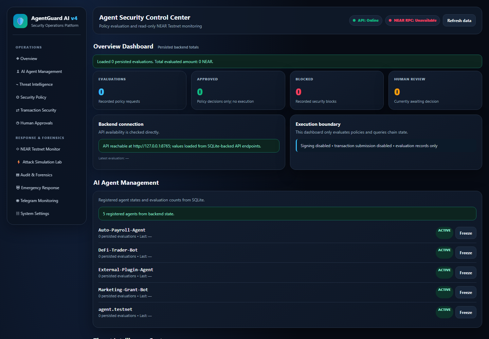

# Verified screenshots

These captures were taken from the locally running v4 FastAPI app on 2026-11-12 using headless Microsoft Edge at a 1440 × 1000 viewport. The review instance used a temporary SQLite database and a temporary admin token held only in the server process environment.

## Overview dashboard

The rendered page showed the actual API connection as online, **0** persisted evaluations and **0 NEAR** evaluated amount in the fresh temporary database, and **NEAR RPC: Unavailable**. The agent rows came from the backend's initialized local agent state. Signing and transaction submission are explicitly shown as disabled. The screenshot does not represent a successful NEAR connection or seeded evaluation results.

## Verification notes

- The screenshot is an actual local browser capture, visually inspected after capture.
- `GET /api/v1/health` returned `status=ok`, `database=ok`, and `execution=disabled`.
- `GET /api/v1/near/health` returned HTTP 503 with `NEAR_RPC_UNAVAILABLE` during the same review session.
- Dashboard API calls were served by the running local foundation app. Protected controls showed unauthenticated states because no admin token was entered into the browser.
- No wallet credentials, private keys, or admin token are present in the image.
